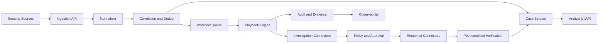

# System overview

## Logical architecture

## Boundaries

- **Ingress**: รับและ authenticate input; ไม่เรียก destructive action
- **Domain**: event, alert, observable และ case; ไม่รู้รายละเอียด vendor API
- **Orchestration**: รัน graph, state, retry และ approval
- **Connector**: แปลง domain action เป็น provider call
- **Policy**: ตรวจ scope, risk, asset criticality, confidence และ approval
- **Evidence/Audit**: เก็บ trace ที่ append-only และ reference ไป artifact
- **Control plane**: admin, schema, playbook และ credential configuration

## Source of truth

SIEM/EDR เป็น source ของ raw telemetry, SOAR เป็น source ของ case/execution/decision, และ DFIR case store เป็น source ของ evidence handling เมื่อมี forensic collection

