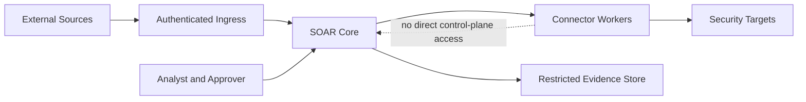

# Trust boundaries

Threats at each boundary:

- external → gateway: spoofed webhook, replay, oversized payload, injection
- gateway → core: tenant confusion, schema abuse, duplicate storm
- core → workers: privilege confusion, command injection, secret exposure
- workers → targets: wrong tenant/asset, excessive permission, destructive blast radius
- core → evidence: privacy leakage, tampering, retention violation
- operator → core: approval fraud, privilege escalation, insider misuse

